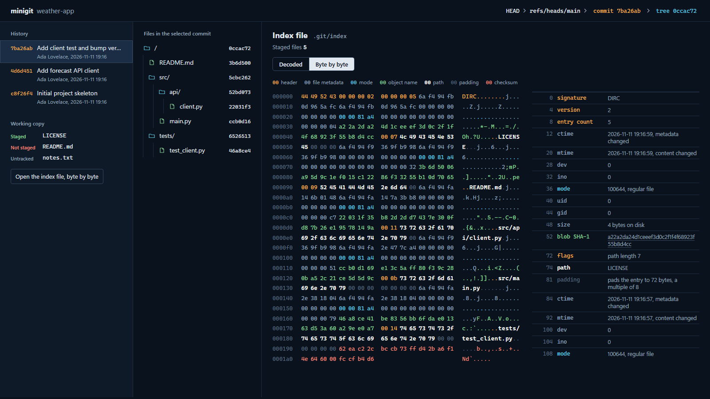

# Git from Scratch

A small Git implementation in pure Python. It reads and writes Git's real on-disk formats:
zlib-compressed objects, the binary index and refs. A repository created with it passes
`git fsck --strict`, and repositories created by Git can be read by it.

It also explains what it writes. Every byte of the index file and of any object can be
labelled with the field it belongs to, on the command line or in a web explorer.

No dependencies. Only the Python standard library.



## Commands

| Command | What it does |
|---|---|
| `init` | Create an empty repository |
| `add <path>...` | Stage files or directories. Staging a deleted path stages the deletion |
| `status` | Staged, unstaged and untracked changes |
| `commit -m <msg>` | Record the staged snapshot |
| `log` | History of the current branch |
| `cat-file -p\|-t <object>` | Print an object's content or type |
| `ls-files`, `ls-tree <tree>`, `write-tree`, `hash-object [-w] <file>` | Plumbing commands |
| `explain index` / `explain <object>` | Label every byte of the index or of an object |

Objects can be named by full SHA, unique prefix, branch name or `HEAD`.

## Usage

Requires Python 3.10 or newer.

```bash
python minigit.py init
```

```bash
python minigit.py add .
```

```bash
python minigit.py commit -m "First commit"
```

The author comes from `user.name` and `user.email` in the Git config, or from the
`GIT_AUTHOR_NAME` and `GIT_AUTHOR_EMAIL` environment variables.

See how the index is laid out on disk:

```bash
python minigit.py explain index
```

```
     0      4  signature     44 49 52 43                 DIRC
     4      4  version       00 00 00 02                 2
     8      4  entry count   00 00 00 05                 5
    12      8  ctime         6a f4 94 fb 0d 96 5a fc     2026-11-11 19:16:59, metadata changed
    36      4  mode          00 00 81 a4                 100644, regular file
    52     20  blob SHA-1    a2 2a 2d a2 4d 1c ee ef ..  a22a2da24d1ceeef3d0c2f1f4f68923f55b8d4cc
    72      2  flags         00 07                       path length 7
    74      7  path          4c 49 43 45 4e 53 45        LICENSE
    81      3  padding       00 00 00                    pads the entry to 72 bytes, a multiple of 8
```

`explain HEAD` does the same for a commit, and `explain <tree>` shows that a tree stores each
child's hash as 20 raw bytes, not as the 40 hex characters Git prints.

Explore any repository in the browser:

```bash
python web.py path/to/repository
```

Then open <http://127.0.0.1:8054>. Every object and the index have a "Byte by byte" view.
Hovering a byte highlights its whole field, and clicking a hash jumps to that object. The
server listens on the loopback interface only.

## How Git stores things

- **Blob**: the content of one file. No name, no permissions.
- **Tree**: one directory. A list of `mode name -> object`, where the object is a blob or
  another tree.
- **Commit**: a pointer to one root tree, plus parent commits, author and message.
- **Object name**: the SHA-1 of `"<type> <size>\0<content>"`. The same content always gets
  the same name, so identical files are stored once.
- **Index**: a sorted binary list of staged files. `commit` turns it into tree objects.
- **Branch**: a text file containing one commit SHA. `HEAD` names the current branch.

## Details that were not obvious

- **A byte map has to account for every byte.** The explain view is only trustworthy if
  nothing is skipped. The segments are checked to cover the data exactly, with no gap and no
  overlap, and a test asserts it for the index and for commit, tree and blob objects.
- **Hashes are stored in two forms.** A commit refers to its tree with 40 hex characters of
  text. A tree refers to its children with 20 raw bytes. Mixing the two up produces objects
  that look right in a text dump and are still invalid.
- **Tree entries are not sorted alphabetically.** Git compares directory names as if they
  ended with `/`. For `a/`, `a-b` and `a.txt` the correct order is `a-b`, `a.txt`, `a`. A
  plain sort puts `a` first, produces a different tree hash, and `git fsck` rejects the tree.
- **Index entries are padded.** Every entry is padded with 1 to 8 NUL bytes so its length is
  a multiple of 8. Being off by one byte makes the rest of the file unreadable. A test covers
  every name length from 1 to 19.
- **Tree modes have no leading zero.** A directory is stored as `40000`, not `040000`, even
  though `git ls-tree` prints six digits.
- **A path cannot be both a file and a directory.** When `a` was a file and is now a
  directory, staging `a/b.txt` must remove the old entry `a`, or the tree cannot be built.
- **Write order matters.** Objects are written before the branch is updated, and each file is
  written to a temporary name and then renamed. A crash can leave unused objects behind but
  never a branch that points to a missing commit.
- **The index lock.** The index is written as `index.lock` and then renamed. Creating the
  lock fails if it already exists, which keeps two processes from writing at the same time.
- **Object names are checked before they become file paths.** The explorer takes object
  names from the URL. Only 40 hex characters are accepted, so `../../` cannot leave `.git`.
- **Same size does not mean unchanged.** `status` hashes a file when its size matches the
  index, so changing `aaaa` to `bbbb` is detected.

## Tests

```bash
python -m unittest
```

18 tests. Several of them run the real `git` binary against the same repository and compare
results: `git fsck --strict` accepts the objects, `git write-tree` returns the same hash,
`git ls-files -s` lists the same index, and `git status` is clean after a commit. One test
goes the other way and reads a repository created by Git. These tests are skipped when `git`
is not installed.

## Limitations

- Loose objects only. Packfiles are not read, so cloned or garbage-collected repositories
  cannot be explored.
- No branches, checkout, merge, diff or network commands.
- No `.gitignore` support: `add .` stages everything.
- No line ending conversion. With `core.autocrlf=true`, Git may report files as modified.
- Index version 2 only, and index extensions are dropped when the index is rewritten.
- `status` always hashes same-sized files instead of trusting cached timestamps.

## License

MIT
